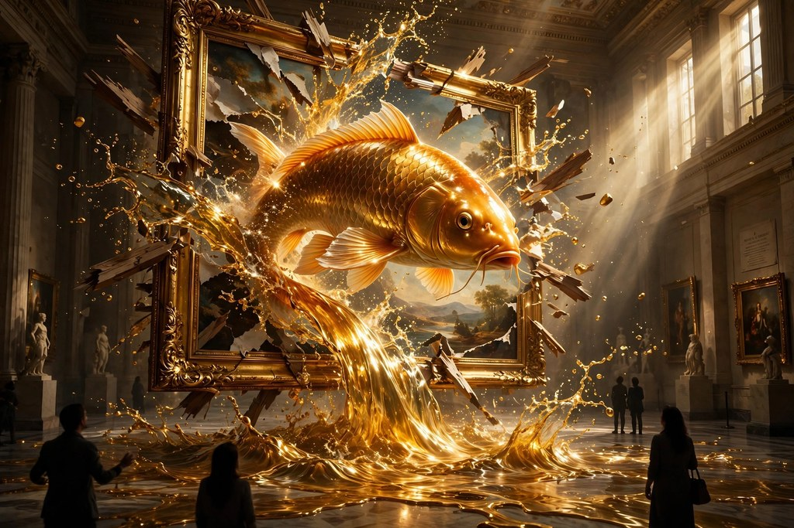

# Koi Emas Menembus Lukisan

[](https://make.fun/bounty/ai-excited-01?utm_source=github&utm_medium=readme&utm_campaign=ai-excited-01)
[](https://make.fun/bounty/ai-excited-01/leaderboard?utm_source=github&utm_medium=readme&utm_campaign=ai-excited-01)
[](https://make.fun/bounty/ai-excited-01?utm_source=github&utm_medium=readme&utm_campaign=ai-excited-01)

[](https://make.fun/bounty/ai-excited-01)

Entry for the make.fun bounty **[Make the AI judge excited](https://make.fun/bounty/ai-excited-01)** (`ai-excited-01`).



## The concept

A giant golden koi smashes out of its ornate golden museum frame — canvas
shredded, liquid gold pouring onto the marble floor, god rays cutting through
the gallery while visitors freeze in awe. A painting that refuses to stay a
painting: the impossible moment, frozen mid-explosion.

Why this image: the winning pattern in this bounty is a creature breaking out
of its frame with gold, scale and drama — awe, wonder and surprise in a single
glance.

## Gambar terpilih

The bundled image is candidate **koi-03-golden-wave**, chosen from the
generated candidates for this entry. Four things decided the pick:

- **Frame-break:** the koi is caught mid-exit — body already outside the
  frame, canvas torn around it. The break is the whole joke of the image:
  the painting refuses to stay a painting.
- **Emas:** gold is not an accent here, it is the palette — the koi, the
  frame, the spilling liquid. Warm, high-contrast gold reads instantly
  even at thumbnail size.
- **Skala mustahil:** a koi far too big for its frame, in a museum gallery
  built for humans. The impossible scale is what makes a viewer stop and
  stare instead of scrolling past.
- **Emosi awe:** the visitors frozen mid-step sell the reaction the judge
  is supposed to feel — surprise turning into wonder in a single glance.

The other candidates lost on those same axes: some kept the koi mostly
inside the frame (no real break, no moment), some used gold only as a
trim (flat, less drama), and some shrank the koi to a believable size
(believable is boring — the awe evaporates). koi-03-golden-wave was the
only candidate that scored on all four at once.

## How the program works

`main.py` (Python 3.13, standard library only) copies the bundled image
`entry.jpg` to `/output/entry.png`. It is fully deterministic — run it twice
and the output bytes are identical.

```sh
mkdir -p out && MAKEFUN_OUTPUT_DIR=out python3 main.py
```

## License

MIT — see [LICENSE](LICENSE).
